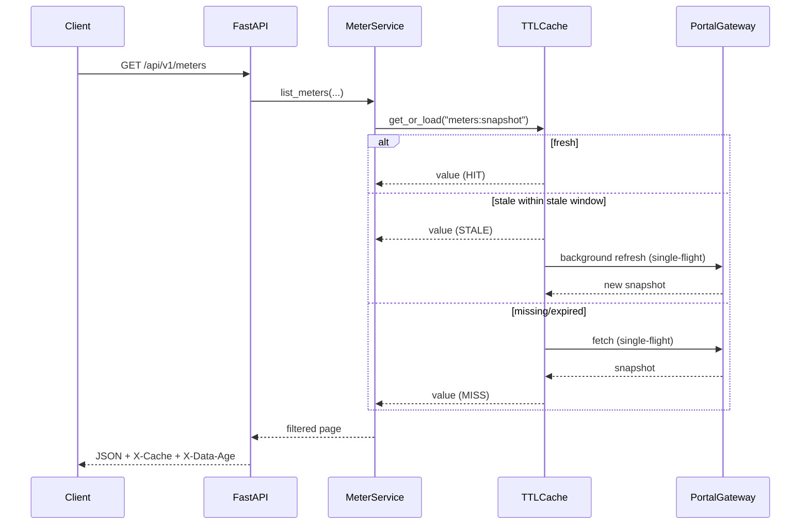

# PROTOCOL: Urja Meter Ops portal

> **Provenance.** The real Urja portal was not reachable from this environment: no base URL or credentials were supplied, and probing an unknown third-party system is out of scope for a read-only take-home. To keep the exercise honest and runnable, I built a deterministic **mock portal** (`mock_portal/`) and wrote the adapter against the contract below. Rows marked **Observed** are reproduced by the mock and covered by tests. Rows marked **ASSUMED** are hypotheses about the real portal that must be verified before production use. This document is the map of that boundary.

The adapter's job is to absorb everything below so that API clients see one clean, typed contract.

---

## 1. Overview

Urja Meter Ops is a legacy, session-based operations portal for electricity meters. The data needed by the API:

- a fleet of meters with identity, status, zone, location, install date, last communication and last reading;
- a flat hierarchy table relating nodes (network / zone / feeder) by parent id;
- per-meter consumption series, available through an XHR JSON endpoint used by the chart page;
- a bulk CSV export for the fleet;
- server-rendered HTML pages for the meter list, meter detail and hierarchy.

The mock stores 24 unique meters (25 CSV rows because of a duplicate id), 13 hierarchy rows, and deterministic consumption series. It intentionally includes the kinds of defects listed in `spec.md` §3.4.

**Observed** (mock) vs **ASSUMED** (real portal): paths, form field names, cookie names, and exact CSS anchors are mock-specific. The *shape* of the problem - form login, cookie session, 200-with-login-page expiry, CSV bulk path, table pages, XHR consumption - is the contract the adapter is designed around.

---

## 2. Authentication flow

### 2.1 Login (Observed in mock)

1. `GET /login` returns an HTML form (`#login-form`) and sets a `urja_csrf` cookie.
2. The form contains a hidden `csrf_token`, plus `email` and `password` inputs.
3. `POST /login` is `application/x-www-form-urlencoded` with `email`, `password`, `csrf_token`.
4. Success: `303 See Other` to `/meters`, `Set-Cookie: urja_session=<opaque>; HttpOnly; SameSite=Lax; Path=/; Max-Age=900`.
5. Failure: `200 OK` re-renders the login form with an error; there is no JSON error and no non-2xx status. A naive client that checks only `status == 200` would treat failure as success, so success is validated by redirect location and absence of the login form.
6. `GET /logout` exists in the mock but the adapter never calls it: the service is read-only and the operator session is shared.

Cookie/session properties in the mock:

| Property | Value | Confidence |
|---|---|---|
| Session cookie | `urja_session`, opaque random token | Observed (mock) |
| CSRF cookie | `urja_csrf`, HttpOnly, 10 min | Observed (mock) |
| Session lifetime | 900 s, absolute in mock | Observed (mock); ASSUMED for real |
| Sliding vs absolute | absolute | Observed (mock); ASSUMED |
| Logout invalidates | yes, server-side token removed | Observed (mock) |
| Bad-password lockout | none in mock; failed attempts counted | ASSUMED real may rate-limit |

The real field names may differ (`email` vs `username`) and the CSRF input may be named differently. The login parser reads the form rather than hard-coding field names, so it adapts if the form keeps the same anchors (`form#login-form`, `input[name=...]`). **[VERIFY]** on the real portal.

### 2.2 Session expiry: three signals, one rule

The mock deliberately uses three different expiry behaviors depending on the data path:

| Data path | Expired response | Why it matters |
|---|---|---|
| HTML pages (`/meters`, `/meters/{id}`, `/hierarchy`) | `200 OK` whose body is the login form | Status-code checks are insufficient. |
| Consumption JSON (`/meters/{id}/consumption/data`) | `401 {"error":"session_expired"}` | Classic XHR behavior. |
| CSV export (`/export/meters.csv`) | `303 /login` | Download endpoints often redirect. |

`app/portal/session.py::is_session_expired` is the single source of truth:

```text
401 or 403                                      -> expired
301/302/303/307/308 with Location containing
  "login"                                       -> expired
200 with HTML/text body containing the login
  marker / form                                 -> expired
```

Every call goes through `PortalSession.request()`, so no fetcher can forget the rule.

### 2.3 Re-authentication sequence

```mermaid
sequenceDiagram
    participant A as Request A
    participant B as Request B
    participant S as PortalSession
    participant T as PortalTransport
    participant P as Portal

    A->>S: request(GET /meters/1)
    B->>S: request(GET /hierarchy)
    S->>T: GET /meters/1
    S->>T: GET /hierarchy
    T->>P: both requests with old cookie
    P-->>T: 200 login HTML / 401 / 303
    T-->>S: responses
    Note over A,B: both observe expiry, both call _reauthenticate(seen_generation)
    A->>S: acquire login lock
    S->>T: GET /login
    T->>P: GET /login
    P-->>T: form + CSRF cookie
    S->>T: POST /login (email, password, csrf)
    T->>P: POST /login
    P-->>T: 303 /meters + new session cookie
    S->>S: authenticated = true; generation += 1
    S-->>A: release lock
    B->>S: acquire lock, see generation changed
    S-->>B: return without another login
    A->>T: retry original GET /meters/1 once
    B->>T: retry original GET /hierarchy once
    T->>P: requests with restored cookie
    P-->>T: 200 data
```

Key properties:

- **Lazy login:** no login on startup unless a request needs data. `/health` never touches the portal.
- **Single-flight:** an `asyncio.Lock` plus a generation counter ensures ten concurrent expired requests cause **one** login. This is tested with `asyncio.gather` in `tests/unit/test_session.py`.
- **Retry once:** after re-auth the original request is retried exactly once. If it is still expired, `PortalAuthError` is raised; there is no login loop.
- **Failure is not retried blindly:** bad credentials trip the transport failure counter and surface as a 503 with `Retry-After`, not a tight login loop.
- **Single shared `httpx.AsyncClient`:** one cookie jar for the process. This is correct for a single operator account; it is not suitable for per-user identities.

### 2.4 Credentials and secrets

- `URJA_USERNAME` / `URJA_PASSWORD` come from env; password is `SecretStr`.
- Credentials are never logged, serialized into API responses, or passed to clients.
- The public API has **no login endpoint**. Login is an internal adapter concern. This is a deliberate trade-off (safer/simpler for one operator; not multi-tenant).
- `.env` is git-ignored; only `.env.example` is committed.

---

## 3. Endpoint catalogue

### 3.1 Mock portal endpoints (private; not part of the public API)

| Method | Path | Params | Response | Auth | Adapter use |
|---|---|---|---|---|---|
| GET | `/login` | `error?` | HTML login form + CSRF cookie | none | `PortalSession._login` |
| POST | `/login` | form: `email`, `password`, `csrf_token` | 303 + session cookie, or 200 form | CSRF | `PortalSession._login` |
| GET | `/meters` | `page` (1-based), `q`, `status` | HTML table `#meters-table`, `#pager[data-page,data-total,data-next]` | session | fallback list pages, readiness probe |
| GET | `/meters/{id}` | none | HTML `#meter-detail[data-meter-id]` with `[data-field]` blocks | session | meter detail |
| GET | `/meters/{id}/consumption/data` | `from`, `to`, `granularity=hourly\|daily\|monthly` | JSON `{unit, points:[{timestamp,value}], ...}` | session | consumption |
| GET | `/hierarchy` | none | HTML `#hierarchy-table` | session | hierarchy |
| GET | `/export/meters.csv` | none | CSV (UTF-8 BOM), `Content-Disposition` | session | bulk fleet snapshot |
| GET | `/health` | none | `{status, service, sessions}` | none | mock healthcheck |
| GET | `/robots.txt` | none | `Disallow: /` | none | not used |
| GET | `/logout` | none | 303 `/login` | session | not called (read-only) |
| POST | `/_control/expire` | none | expire all sessions | mock-only | demo/tests |
| GET | `/_control/stats` | none | login/session counters | mock-only | demo/tests |
| POST | `/_control/reset` | none | reset counters/sessions | mock-only | tests |

**ASSUMED** real-portal mapping: the exact paths above are mock paths. The adapter centralizes them in `PortalGateway`, so a real path change is a small, testable edit, not a refactor.

### 3.2 Public API endpoints (the contract clients see)

| Method | Path | Parameters | Notes |
|---|---|---|---|
| GET | `/health` | none | Liveness only; no portal call. |
| GET | `/ready` | none | Portal probe cached for `READINESS_PROBE_TTL_S`; 503 when not ready. |
| GET | `/api/v1/meters` | `page`, `page_size`, `status`, `q`, `zone` | Bulk-first snapshot, in-process filters, explicit quality summary. |
| GET | `/api/v1/meters/search` | `lat`, `lon`, `radius_km`, `page`, `page_size`, `status` | Bounding-box prefilter + haversine; missing coords excluded. |
| GET | `/api/v1/meters/{id}` | path id, case-insensitive/trimmed | Detail + hierarchy path + list/detail conflict flags. |
| GET | `/api/v1/meters/{id}/consumption` | `from`, `to`, `granularity` | Default last 7 days; max 366-day range; current vs closed TTL. |
| GET | `/api/v1/hierarchy` | `root`, `depth` (0-10) | Both nested tree and flat nodes; defect counters. |
| GET | `/api/v1/stats/summary` | none | Aggregates over cached snapshot. |
| POST | `/api/v1/admin/cache/refresh` | header `X-API-Key` | Invalidates then re-warms meters + hierarchy. |
| GET | `/docs`, `/reference`, `/openapi.json` | none | Swagger / Scalar / committed schema. |

### 3.3 Pagination, filtering, sorting

- **Portal list page:** 10 rows per page, `#pager[data-total]` counts **duplicate rows** (25), `data-next` is empty on the last page. Real portal pagination is **ASSUMED** to be stable and 1-based; the fallback loop guards against repeated/self-referential `next` and caps at 100 pages.
- **Bulk CSV:** 25 rows including the duplicate; the adapter deduplicates by canonical id.
- **Public API:** page/page-size, max 100, default 20; `next_page` is `null` on the last page. Filtering is case-insensitive substring over id, serial, display name, zone id and zone name; status and zone are exact after normalization. Results are sorted by canonical meter id. Geo results are sorted by `(distance_km, id)`.
- **Why bulk first:** one request, all metadata, no pagination drift. Detail pages are only used for fields absent from the bulk export.

---

## 4. Data model

### 4.1 Meter (bulk + list)

| Field | Type | Source / rule |
|---|---|---|
| `id`, `portal_id` | string | `meter_id` trimmed, whitespace removed, uppercased. |
| `serial_number` | string \| null | `serial_no`; `N/A`/`-`/empty -> null + `serial_missing`. |
| `display_name` | string | `display_name`; empty/`N/A` -> fallback to id + `name_missing`. |
| `status` | `ACTIVE \| INACTIVE \| FAULT \| UNKNOWN` | `status` mapped; unknown preserved as `UNKNOWN`. |
| `status_raw` | string \| null | Exact source string, including case. |
| `zone_id` | string \| null | Canonicalized `zone_id`. |
| `zone_name` | string \| null | Source label; may be absent on fallback list pages. |
| `latitude`, `longitude` | float \| null | Parsed numbers; incomplete/invalid -> both null + flags. |
| `install_date` | date \| null | Parsed; invalid -> null + `invalid_date`. |
| `last_seen_at` | UTC datetime \| null | Naive assumed portal tz + flag; invalid -> null. |
| `last_reading` | float \| null | Number parser; unit may be embedded. |
| `last_reading_unit` | string \| null | Embedded unit wins, else `last_reading_unit` column. |
| `quality_flags` | string[] | Non-fatal defects, deduplicated. |

### 4.2 Meter detail (adds)

`address`, `meter_type`, `phase`, `multiplier`, `hierarchy_path` (names from root to the meter's zone), `source` (`source=meter_page`). Detail values are authoritative for detail-only fields. List/detail differences in serial or status are **reported**, not overwritten silently.

### 4.3 Consumption

| Field | Type | Rule |
|---|---|---|
| `meter_id` | string | Canonical id. |
| `from`, `to` | UTC datetime | Query range; echoed as `"from"` (alias) and `"to"`. |
| `granularity` | `hourly \| daily \| monthly` | Requested granularity; echoed. |
| `unit` | string | `kWh` by default; embedded per-point units are parsed and preserved in the summary unit. |
| `points` | array | `{timestamp: UTC, value: number\|null, quality_flags}`; sorted ascending. |
| `summary` | object | total/min/max/average over non-null values; non-null and missing counts; unit. |
| `quality_flags` | string[] | Series-level defects. |
| `source` | object | `source=consumption_json`, `fetched_at`. |

### 4.4 Hierarchy

| Field | Type | Rule |
|---|---|---|
| `id` | string | Canonical node id. |
| `name` | string | Source label, fallback to id. |
| `type` | string | Lowercased `network`, `zone`, `feeder`, `unassigned`. |
| `parent_id` | string \| null | Canonical parent; synthetic ids for repaired edges. |
| `level` / `level_raw` | int \| null / string | First numeric run normalized; raw kept. |
| `meter_count` | int | Meters in this subtree (rolled up). |
| `quality_flags` | string[] | `orphan`, `cycle_broken`, `duplicate_in_source`, `multiple_parents_in_source`, `synthetic`. |
| `children` | node[] | Nested tree (optional depth). |
| `has_more_children` | bool | True when depth truncates children. |

**IDs and relationships:** `meter.zone_id` points at a hierarchy node id. The path is walked from the node up to a root, then reversed. Unknown zone ids count toward the synthetic `__unassigned__` branch and produce `zone_not_in_hierarchy` on meter detail.

### 4.5 Status vocabulary

| Source examples | Normalized |
|---|---|
| `Active`, `ACTIVE`, `active`, `1`, `ON`, `RUNNING` | `ACTIVE` |
| `Inactive`, `0`, `OFF`, `DISCONNECTED` | `INACTIVE` |
| `FAULT`, `Fault`, `FAULTY`, `ERROR`, `ALARM` | `FAULT` |
| `N/A`, `""`, `-`, `null`, anything unmapped | `UNKNOWN` + `status_missing` or `status_vocabulary_unmapped` |

Unknown is never coerced to inactive: that would hide a reporting failure.

### 4.6 Number rules

| Input | Output | Flags |
|---|---|---|
| `"120.5"` | 120.5 | none |
| `"1,24,500"` | 124500 | none (Indian grouping) |
| `"1,234.56"` | 1234.56 | none |
| `"1.234,56"` | 1234.56 | `decimal_comma` |
| `"12,5"` | 12.5 | `decimal_comma` |
| `"124.50 kWh"` | 124.5, unit `kWh` | none |
| `"N/A"`, `"-"`, `""` | null | none |
| `"abc"` | null | `number_parse_error` |
| `"1,2,3,4"` | 1234 | `number_grouping_ambiguous` |

Unit normalization recognizes `kWh`, `kW`, `MWh`, `Wh`, `kVA` case-insensitively.

### 4.7 Date rules

| Input | Output / flags |
|---|---|
| `2025-01-10` | date |
| `01/03/2026` | 2026-03-01 + `date_ambiguous_day_first_assumed` |
| `1 Mar 26` | 2026-03-01 |
| `2026-13-40` | null + `invalid_date` |
| `2026-02-30` | null + `invalid_date` |
| `2026-03-01 10:15:00` (naive) | 10:15 IST -> 04:45Z + `naive_datetime_assumed_portal_tz` |
| `2026-03-01T10:15:00+05:30` | 04:45Z (offset honored) |
| `N/A` | null, no flag |

Day-first is assumed for `DD/MM/YYYY`; ambiguity is flagged whenever both leading components are <= 12. Portal-local time is `URJA_TIMEZONE` (default `Asia/Kolkata`). API output is always UTC with `Z`/offset.

---

## 5. Quirks and anomalies (with real examples from the mock)

| # | Quirk | Example | Adapter behavior / flag |
|---|---|---|---|
| 1 | Duplicate meter id with conflicting values | `MTR-0004` appears twice: primary `serial=SN-0004`, `status=FAULT`; duplicate `serial=SN-0004-B`, `status=ACTIVE` | Deterministic first/completeness rule keeps one; `duplicate_in_source`, `conflicting_source_rows`; `duplicate_ids=1`. |
| 2 | Whitespace/case in id | `" MTR-0011 "` | Canonicalized to `MTR-0011`; whitespace removed. |
| 3 | Missing serial | `MTR-0010` has `serial_no=N/A` | `serial_number=null`, `serial_missing`. |
| 4 | Missing display name | `MTR-0011` has `display_name=""` | Falls back to id + `name_missing`. |
| 5 | Missing coordinates | `MTR-0008`, `MTR-0020`, `MTR-0021` have empty lat/lon | Both null, `missing_coordinates=3`; excluded from geo search. |
| 6 | Unknown zone id | `MTR-0020` zone `ZN-404`; `MTR-0021` zone `ZN-ROOT` | Meter retains raw zone id; hierarchy rolls unknown zone into `__unassigned__`; detail adds `zone_not_in_hierarchy`. |
| 7 | Status drift | `Active`, `active`, `ACTIVE`, `1`, `0`, `FAULT`, `Fault`, `N/A`, `""` | Normalized enum; raw kept in `status_raw`; unknown statuses flagged. |
| 8 | Mixed install date formats | `2025-01-10`, `01/03/2026`, `1 Mar 26`, `2026-13-40`, `2026-02-30` | Valid parsed; invalid -> null + `invalid_date`; ambiguous day-first flagged. |
| 9 | Mixed last-seen formats | ISO with offset, naive ISO, `01/03/2026 10:15`, `N/A`, `2026-13-40T00:00:00` | UTC normalization; naive assumed portal tz; invalid -> null + `invalid_datetime`. |
| 10 | Number formatting | `1,24,500`; `124.50 kWh`; `1.234,56`; `12,5`; `N/A`; `-` | Parsed with explicit flags where lossy/ambiguous; units preserved. |
| 11 | List vs detail conflict | Bulk `MTR-0011 serial=SN-0011`; detail `SN-0011-REV` | Detail wins for detail fields; `list_detail_field_conflict`. |
| 12 | Duplicate hierarchy node with two parents | `ZN-N2` under `ZN-NORTH`, then again under `ZN-EAST` | First kept; `duplicate_in_source`, `multiple_parents_in_source`; `duplicates=1`, `multiple_parents=1`. |
| 13 | Orphan node | `ZN-ORPHAN` parent `ZN-GHOST` (missing) | Attached under synthetic `__unassigned__`; `orphan`; `orphans=1`. |
| 14 | Cycle | `ZN-CYC-A -> ZN-CYC-B -> ZN-CYC-A` | Break at lexicographically smallest id (`ZN-CYC-A`), reparent to `__unassigned__`; both `cycle_broken`; `cycles=1`. |
| 15 | Multiple roots | `ZN-ROOT` and `ZN-ISLAND` have empty parent | Both attached under synthetic `__network__` ("Urja Network"). |
| 16 | Inconsistent level strings | `0`, `L1`, `level-2`, `3` | First numeric run extracted; `level_raw` retained; non-numeric -> `level_not_numeric`. |
| 17 | Missing consumption values | `MTR-0014` index 2 `null`, index 4 `"-"` | `value=null`, point flag `missing_value`; series flag `missing_values`; summary counts them. |
| 18 | Negative consumption | `MTR-0015` index 3 `-5.50` | Preserved (not clamped); point `negative_value`; series `negative_values`. |
| 19 | Duplicate timestamp | `MTR-0016` index 2 has two points at the same timestamp | First kept; `duplicate_timestamps_dropped`; no silent double count. |
| 20 | Series gaps | `MTR-0017` skips every third bucket | `_count_gaps` sees >1.5x expected delta; `series_gaps`. |
| 21 | Naive consumption timestamp | `MTR-0019` index 1 has no offset | Assumed portal tz; `naive_timestamps_assumed_portal_tz`. |
| 22 | Unit embedded in value | `MTR-0022` index 1 `12.34 kWh` | Unit parsed; numeric value preserved. |
| 23 | Reversed series | `MTR-0003` points arrive newest-first | Sorted ascending before serving; no flag (ordering is not lossy). |
| 24 | CSV BOM | Export begins with UTF-8 BOM | Stripped before `csv.DictReader`. |
| 25 | Pagination total counts duplicates | `#pager[data-total=25]`, unique ids = 24 | API reports `total=24` after dedupe; `duplicate_ids=1`. |
| 26 | Login failure is `200` | Wrong password re-renders login form | Success requires redirect/non-login body, not just 2xx. |
| 27 | Expiry is different per path | HTML: `200` login form; JSON: `401`; CSV: `303 /login` | One `is_session_expired` rule; single-flight re-auth. |

### Lossy operations (explicitly listed)

- Duplicate source rows collapse to one record; the discard is counted/flagged.
- Invalid dates/timestamps become `null`; the source text is not preserved in the public model (it is visible through flags/counters).
- Duplicate consumption timestamps drop the later value; series is sorted.
- Ambiguous numbers/dates are interpreted with a documented rule and flagged.
- No value is clamped, interpolated, or invented.

---

## 6. Bulk/export path

**Observed** (mock): `GET /export/meters.csv` returns all 25 rows (24 unique) as UTF-8 with BOM and `Content-Disposition: attachment`. Columns: `meter_id`, `serial_no`, `display_name`, `status`, `zone_id`, `zone_name`, `latitude`, `longitude`, `installed_on`, `last_seen`, `last_reading`, `last_reading_unit`, `meter_type`.

Why prefer it:

- one request instead of 3+ paginated HTML pages;
- richer metadata (coordinates, dates, readings) than the list table;
- stable column headers suitable for header-based mapping;
- easier to detect duplicate ids and whole-file structural change.

Fallback: if the export is missing, returns a non-CSV body, lacks required columns, or normalizes to zero usable rows, the service fetches paginated `/meters` pages and builds a reduced snapshot (`source=list_pages`). The list page omits address, phase, multiplier, coordinates, install date and readings, so detail pages still supply those per-meter fields. A structural parser failure is a `502`; it is never an empty list.

The public API exposes provenance in every payload: `source.source` is `bulk_csv`, `list_pages`, `meter_page`, `consumption_json` or `hierarchy_page`.

---

## 7. Rate limits, performance, and courtesy

- Mock: no rate limit; local responses in single-digit milliseconds; session TTL 900 s; one login per session.
- Adapter: max 5 concurrent portal requests; GET retries capped at 2 with exponential backoff + jitter; circuit breaker after 5 consecutive failures; readiness probe cached 10 s.
- Fleet data is fetched once and cached; details/consumption are fetched on demand; the admin refresh is the only explicit re-warm.
- Real portal limits, login lockout, and typical latency: **unknown / [VERIFY]**. Do not run the live suite against production without permission.

---

## 8. Error mapping

| Adapter condition | HTTP | Title |
|---|---|---|
| Meter/node unknown | 404 | `Not found` |
| Query/path validation | 422 | `Invalid request parameters` |
| Table/section/header missing; unparseable CSV/JSON | 502 | `Portal response could not be understood` |
| Connect failure / 5xx / 429 / circuit open | 503 | `Portal unavailable` / `Portal temporarily unavailable` |
| Login rejected / session cannot be restored | 503 | `Portal authentication unavailable` |
| Total deadline or read timeout | 504 | `Portal timeout` |
| Unexpected bug | 500 | `Internal server error` |

All bodies use `application/problem+json` with `type`, `title`, `status`, `detail`, `instance`, `request_id`, and optional `errors`. Status-specific `Retry-After` is set for 503/504.

---

## 9. Observability and security

- Structured JSON logs with timestamp, level, logger, message, request id, method, path, status, duration and cache outcome. Portal credentials and cookies are never logged.
- `X-Request-ID` is echoed on responses and included in problem details; `X-Response-Time-Ms`, `X-Cache`, `X-Data-Age` are exposed.
- `/ready` reports portal reachability, session authentication, breaker state, cache entries and in-flight refreshes.
- Admin refresh requires `X-API-Key`; comparison is constant-time.
- TLS verification is never disabled; the adapter only exposes GET plus the internal login POST.
- CORS is env-driven and defaults to the local console origins (`http://localhost:8000`, `http://127.0.0.1:8000`); set an explicit allowlist for any separate frontend.

---

## 10. Open questions / what must be verified on the real portal

1. **Base URL and credentials.** None were supplied. All live behavior is therefore untested.
2. **Login form details.** Exact field names, whether CSRF rotates per request, cookie names/attributes, session TTL and sliding behavior.
3. **Expiry behavior.** Confirm the three signals and whether any page returns a different pattern (e.g. 200 with a generic error).
4. **Bulk export.** Exact path, delimiter, encoding, header names, whether it is generated asynchronously, and whether it includes duplicate rows.
5. **List pagination.** Page size, total semantics, last-page behavior, filter support, sorting.
6. **Detail anchors.** `#meter-detail` / `data-field` names and whether some fields are hidden or lazy-loaded.
7. **Consumption endpoint.** Query names, timezone/DST semantics, maximum range, units, granularity support, whether negative/missing points are possible, and whether the chart uses the same XHR.
8. **Hierarchy path.** Is it a page, a JSON endpoint, or embedded in another page? Are node ids stable?
9. **Conditional GETs.** Are `ETag` / `Last-Modified` present? If yes, replace time-only freshness with revalidation.
10. **Rate limiting and lockout.** Unknown; keep concurrency/retries conservative.
11. **Scale.** Fleet size and hierarchy depth; the current in-memory snapshot assumes ~10^5 meters or fewer.
12. **Status vocabulary and coordinates.** Confirm the real enum and whether coordinates are WGS84.

---

## 11. Adapter mapping (raw -> public)

| Raw source | Field | Public field | Transformation |
|---|---|---|---|
| CSV / list | `meter_id` | `id`, `portal_id` | trim, remove internal whitespace, uppercase |
| CSV / list | `serial_no` | `serial_number` | empty tokens -> null |
| CSV / list | `display_name` | `display_name` | fallback to id |
| CSV / list | `status` | `status`, `status_raw` | map enum, keep raw |
| CSV / list | `zone_id` | `zone_id` | canonical id |
| CSV / list | `latitude`, `longitude` | `latitude`, `longitude` | number parser, range check |
| CSV / list | `installed_on` | `install_date` | multi-format date parser |
| CSV / list | `last_seen` | `last_seen_at` | multi-format datetime parser -> UTC |
| CSV / list | `last_reading`, `last_reading_unit` | same | number/unit parser |
| Detail | `address`, `meter_type`, `phase`, `multiplier` | same | clean/number parser |
| Detail | conflict vs snapshot | `quality_flags` | `list_detail_field_conflict` / `list_detail_status_conflict` |
| Hierarchy | `node_id`, `parent_id`, `name`, `type`, `level` | same + path | canonicalize, tree build |
| Consumption | `points[].timestamp`, `points[].value` | `points` | parse, UTC, dedupe, sort, flag |
| Consumption | `unit` | `unit` | normalize |
| Any | fetch time | `source.fetched_at` | UTC now |

---

## 12. Sequence: request with stale cache



If the portal is down and a stale entry exists, the response is still served with `X-Cache: STALE`; if no entry exists, the portal error maps to 502/503/504 problem+json.
