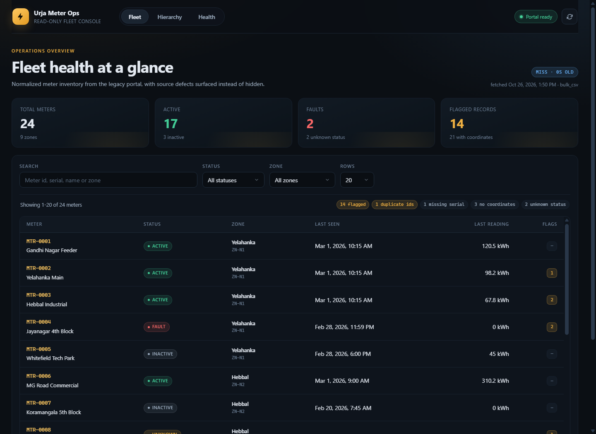
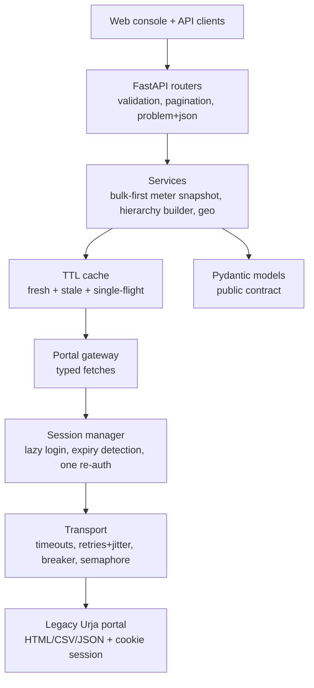

# Urja Meter Ops API

A read-only, resilient REST API and operations console in front of the legacy **Urja Meter Ops** portal. Clients get typed JSON; the portal's HTML, cookies, credentials and defects stay behind an anti-corruption layer.



## What it does

- **Meters** - list, filter, search, inspect, and query consumption series.
- **Hierarchy** - nested tree plus flat nodes, with counted source defects (orphans, cycles, duplicate ids, multiple parents).
- **Geo search** - bounding-box prefilter plus haversine distance from the normalized bulk export.
- **Resilience** - lazy form login with single-flight re-authentication, one retry after expiry, bounded retries with jitter, circuit breaker, concurrency cap, and sticky stale-while-revalidate caching.
- **Operations** - structured JSON logs, request ids, `X-Cache` / `X-Data-Age`, `/health`, `/ready`, and an API-key-protected cache refresh.
- **Self-documenting** - Swagger at `/docs`, Scalar at `/reference`, committed `openapi.json`, and RFC 9457 `application/problem+json` errors.
- **Web console** - no-build dashboard at `/` for fleet KPIs, meters, consumption chart, hierarchy defects and readiness (vanilla JS/SVG, no external CDN).

## Important: the real portal was not available

The take-home points at an Urja portal, but no URL or credentials were provided in this environment. Rather than invent certainty, the repository ships a **deterministic mock portal** (`mock_portal/`) that reproduces the awkward parts a legacy session app is likely to have: CSRF form login, three different session-expiry signals, a bulk CSV export, server-rendered tables, and a deliberately defective dataset.

The adapter is written against the contract documented in [`PROTOCOL.md`](PROTOCOL.md). Point `URJA_BASE_URL`, `URJA_USERNAME`, and `URJA_PASSWORD` at the real portal to use it there. Any real-portal differences should be treated as protocol unknowns, not as silently tolerated failures.

## Quick start

Requires Python 3.11+ (tested on 3.13) and, for Docker, Docker Desktop. For a copy-paste walkthrough with verification and troubleshooting, see [`HOW_TO_RUN.md`](HOW_TO_RUN.md).

### Local (two terminals)

```powershell
python -m venv .venv
.\.venv\Scripts\Activate.ps1
pip install -e ".[dev]"
```

```powershell
# terminal 1 - legacy portal stand-in
uvicorn mock_portal.app:app --port 9000 --reload
```

```powershell
# terminal 2 - public API
uvicorn app.main:app --port 8000 --reload
```

Open <http://127.0.0.1:8000>. On macOS/Linux, use `source .venv/bin/activate` and the same `pip`/`uvicorn` commands.

### Docker

```powershell
docker compose up --build
```

- Console/API: <http://127.0.0.1:8000>
- Mock portal: <http://127.0.0.1:9000> (not part of the public contract)

### First requests

```bash
curl "http://127.0.0.1:8000/api/v1/meters?status=FAULT&page_size=5"

curl "http://127.0.0.1:8000/api/v1/meters/MTR-0011"

curl "http://127.0.0.1:8000/api/v1/meters/MTR-0014/consumption?from=2026-02-01T00:00:00Z&to=2026-02-10T00:00:00Z&granularity=daily"

curl -X POST -H "X-API-Key: dev-admin-key" \
  "http://127.0.0.1:8000/api/v1/admin/cache/refresh"
```

## API

Base path: `/api/v1`. All timestamps are ISO-8601 UTC. All money-like numbers are real JSON numbers; units are explicit.

| Method | Path | Purpose |
|---|---|---|
| GET | `/health` | Liveness; never calls the portal. |
| GET | `/ready` | Portal reachable, session authenticated, breaker/cache state. |
| GET | `/api/v1/meters` | Paginated inventory; `page`, `page_size`, `status`, `q`, `zone`. |
| GET | `/api/v1/meters/search` | Nearby meters; `lat`, `lon`, `radius_km`, `status`. |
| GET | `/api/v1/meters/{id}` | Detail plus hierarchy path. |
| GET | `/api/v1/meters/{id}/consumption` | Points, summary, quality flags; `from`, `to`, `granularity`. |
| GET | `/api/v1/hierarchy` | Nested tree and flat nodes; `root`, `depth`. |
| GET | `/api/v1/stats/summary` | Fleet aggregates for dashboards. |
| POST | `/api/v1/admin/cache/refresh` | Invalidate and re-warm caches; `X-API-Key`. |

Pagination is page/page-size across the API, with `page_size <= 100` and `next_page: null` on the last page. The portal's own page size is not exposed.

### Error shape

Every error is `application/problem+json`:

```json
{
  "type": "about:blank",
  "title": "Not found",
  "status": 404,
  "detail": "meter detail MTR-9999 was not found on the portal",
  "instance": "/api/v1/meters/MTR-9999",
  "request_id": "c0f1d8e6fca54e0e8f3f2c1e9d7a6b5c"
}
```

Status mapping: `401` missing/invalid admin key, `404` unknown meter/node, `422` invalid parameters, `502` unparseable portal HTML, `503` portal unavailable/auth failure/circuit open, `504` portal timeout. `Retry-After` is set where retrying can help.

### Sample response

`GET /api/v1/meters?page_size=1` (excerpt):

```json
{
  "items": [
    {
      "id": "MTR-0001",
      "portal_id": "MTR-0001",
      "serial_number": "SN-0001",
      "display_name": "Gandhi Nagar Feeder",
      "status": "ACTIVE",
      "status_raw": "Active",
      "zone_id": "ZN-N1",
      "zone_name": "Yelahanka",
      "latitude": 12.938,
      "longitude": 77.54,
      "install_date": "2025-01-10",
      "last_seen_at": "2026-03-01T04:45:00Z",
      "last_reading": 120.5,
      "last_reading_unit": "kWh",
      "quality_flags": []
    }
  ],
  "page": 1,
  "page_size": 1,
  "total": 24,
  "next_page": 2,
  "data_quality": {
    "flagged_meters": 14,
    "duplicate_ids": 1,
    "malformed_rows": 0,
    "missing_serial": 1,
    "missing_coordinates": 3,
    "unknown_status": 2
  },
  "source": {
    "system": "urja-meter-ops",
    "source": "bulk_csv",
    "fetched_at": "2026-10-26T07:41:19.780070Z"
  }
}
```

Consumption response excerpt (`MTR-0014`, daily):

```json
{
  "meter_id": "MTR-0014",
  "from": "2026-02-01T00:00:00Z",
  "to": "2026-02-04T00:00:00Z",
  "granularity": "daily",
  "unit": "kWh",
  "points": [
    {"timestamp": "2026-01-31T18:30:00Z", "value": 12.12, "quality_flags": []},
    {"timestamp": "2026-02-01T18:30:00Z", "value": 12.05, "quality_flags": []},
    {"timestamp": "2026-02-02T18:30:00Z", "value": null, "quality_flags": ["missing_value"]}
  ],
  "summary": {
    "total": 37.87,
    "minimum": 12.05,
    "maximum": 13.7,
    "average": 12.623,
    "non_null_points": 3,
    "missing_points": 1,
    "unit": "kWh"
  },
  "quality_flags": ["missing_values"],
  "source": {"system": "urja-meter-ops", "source": "consumption_json", "fetched_at": "..."}
}
```

## Architecture



The boundary is deliberate: **fetch** (HTTP) -> **parse** (HTML/CSV/JSON to raw strings) -> **normalize** (typed models and quality flags) -> **serve**. Parsers and normalizers are pure and fixture-tested; the portal's shapes never leak out.

### Bulk-first ingestion

The CSV export is preferred for the fleet snapshot: one request yields all meters and their metadata. The paginated HTML list is a fallback only if the export is missing or structurally broken. Detail pages are used only for fields the bulk export lacks (address, phase, multiplier). This keeps portal traffic low and makes list/filter/geo operations local.

### Data quality is a feature

Nothing is silently repaired. The mock exercises duplicate ids with conflicting values, whitespace/case ids, missing serials and coordinates, unknown zones, drifting status vocabularies, invalid dates, Indian digit grouping, decimal commas, embedded units, list-vs-detail conflicts, hierarchy orphans/cycles/multiple parents, and consumption gaps/negatives/duplicates/naive timestamps/reversed order. Each becomes a `quality_flags` value and/or a `data_quality` counter. See `PROTOCOL.md` for the full table with examples.

## Resilience and caching

| Mechanism | Implementation |
|---|---|
| Timeouts | Explicit connect/read plus total deadline per attempt. |
| Retries | GET only, max 2 retries, exponential backoff with jitter, only connect errors / 502 / 503 / 504. No 4xx retries. |
| Circuit breaker | Consecutive-failure threshold, open window, one half-open probe; fails fast with 503 and `Retry-After`. |
| Concurrency | `asyncio.Semaphore` caps in-flight portal requests at 5. |
| Session expiry | One rule recognizes 401/403, redirect to `/login`, and HTTP 200 that is actually the login form. Re-auth is single-flight and retried exactly once. |
| Cache | Per-key fresh and stale windows; stale data served while one background refresh runs; TTL jitter; manual refresh. |
| Coalescing | Concurrent misses for the same key share one upstream fetch. |

TTL defaults (seconds): meters `600/3600`, meter detail `300/1800`, current consumption `120/3600`, closed consumption `3600/86400`, hierarchy `600/3600`. `X-Cache` is `HIT`, `STALE` or `MISS`; `X-Data-Age` is seconds since fetch.

Staleness is time-based because the mock (and the assumed portal) exposes no change signal. If the real portal returns `ETag` / `Last-Modified`, conditional GETs are the next step; see `PROTOCOL.md`.

## Configuration

All settings are environment variables (`pydantic-settings`), with a committed `.env.example` and an ignored `.env`.

| Variable | Default | Notes |
|---|---|---|
| `URJA_BASE_URL` | `http://127.0.0.1:9000` | Server-side only. |
| `URJA_USERNAME` / `URJA_PASSWORD` | demo values | `SecretStr`; never logged. |
| `URJA_TIMEZONE` | `Asia/Kolkata` | Naive portal times are assumed here. |
| `ADMIN_API_KEY` | `dev-admin-key` | Change outside local dev. |
| `CORS_ORIGINS` | local console origins | Comma-separated allowlist; set explicitly for a separate frontend. |
| `PORTAL_*_TIMEOUT_S` | `3 / 10 / 15` | Connect / read / total. |
| `PORTAL_MAX_RETRIES` | `2` | GET only. |
| `BREAKER_FAILURE_THRESHOLD` | `5` | Consecutive failures. |
| `BREAKER_RESET_TIMEOUT_S` | `20` | Open window. |
| `CACHE_*_FRESH_S` / `CACHE_*_STALE_S` | see above | Two lifespans per class. |
| `WARM_CACHE_ON_STARTUP` | `false` | Opt-in background warm-up. |
| `MOCK_SESSION_TTL_SECONDS` | `900` | Mock only. |
| `MOCK_CONTROL_ENABLED` | `true` | `/_control/*` endpoints for demos/tests. |

## Tests, lint, types

```powershell
.\.venv\Scripts\pytest.exe -q
.\.venv\Scripts\ruff.exe check .
.\.venv\Scripts\ruff.exe format --check .
.\.venv\Scripts\mypy.exe app mock_portal scripts
.\.venv\Scripts\python.exe scripts\export_openapi.py
```

- 77 tests + 1 skipped live test; covers normalization quirks, fixture parsing, cache SWR/single-flight, hierarchy defects, retry/breaker behavior, session expiry and exactly-one re-auth under 10 concurrent requests, API contracts, problem+json shapes, and OpenAPI drift.
- `tests/live` is opt-in and read-only: set `RUN_LIVE_TESTS=1` plus real portal env, then `pytest -m live`. It never runs in CI.
- Fixtures were captured from the mock through a real httpx session and scrubbed of CSRF/session tokens; `scripts/capture_fixtures.py` regenerates them.
- CI (`.github/workflows/ci.yml`) runs ruff, format check, mypy, OpenAPI regeneration + `git diff --exit-code`, and the test suite.

### Exercising resilience manually

```bash
curl -X POST http://127.0.0.1:9000/_control/expire
curl http://127.0.0.1:8000/api/v1/meters/MTR-0002   # transparent re-auth
curl http://127.0.0.1:9000/_control/stats            # successful_logins == 2
```

## Design decisions and trade-offs

- **Bulk CSV first, HTML fallback second.** Fewer portal calls and richer data; the fallback keeps the API alive if export shape changes. The fallback is best-effort because the legacy list page omits several metadata columns.
- **In-process cache, not SQLite/Redis.** The spec's index is optional and the dataset is small. Filtering, geo search, and stats run over an immutable in-memory snapshot, which is simpler and avoids a second cache. This is single-process by design.
- **One operator session.** Correct for a read-only internal proxy. It would be wrong for per-user identities or horizontal scaling; see "Intentionally skipped".
- **Stale-while-revalidate with explicit headers.** Serving stale data during a portal outage is better than a 503 for dashboards, provided the age is visible. Clients can choose to reject stale responses.
- **Quality flags, not repairs.** Guessing a date or dropping a negative value is lossy. Flags preserve trust and make the portal's condition visible.
- **Global page/page-size pagination.** Matches the rest of the API and is easy for clients; cursor pagination would be better for very large fleets.
- **No-build web console.** Plain JS + SVG avoids a Node toolchain and CDN dependency for a take-home; React/Recharts would be more productive for a larger product.
- **Problem+json everywhere.** One error shape is easier to consume than FastAPI defaults mixed with raw portal failures.
- **Mock portal as a first-class artifact.** It makes the whole system runnable and testable without the real service, and it documents assumptions in executable form.

## Assumptions

- The portal is session-cookie based with a CSRF-protected form login at `/login`; a lost session can surface as 401, a redirect, or a 200 login page.
- The bulk export at `/export/meters.csv` is authoritative for list fields; detail pages override only non-bulk fields. If they conflict, the API reports it instead of hiding it.
- Portal timestamps are in `Asia/Kolkata` when no offset is present. Day-first parsing is assumed for ambiguous `DD/MM/YYYY` values. Both assumptions are flagged.
- The hierarchy is small enough to rebuild per request from a cached flat table; a very large tree would need a materialized index.
- Meter status vocabulary includes `Active/active/1`, `Inactive/0`, `Fault/FAULT`, and unknown values. Unknown values are not coerced to inactive.
- Coordinates, when present, are WGS84 degrees.
- The real portal may have different paths, fields, or expiry behavior; `PROTOCOL.md` marks which parts are observed from the mock versus assumed.

## Intentionally skipped

- Any portal write, including logout and configuration changes.
- Multi-tenant auth, per-user portal credentials, RBAC, and a login endpoint.
- Horizontal session sharing (Redis / gateway worker).
- Real-time streaming, webhooks, or push updates.
- SQLite/PostGIS indexing; geo search is linear over the snapshot.
- Prometheus/OpenTelemetry exporters; structured logs + `/ready` are the observability hooks.
- A map view, saved views, alerting, and background jobs.
- Live-portal verification, because no endpoint or credentials were supplied.

## With more time

1. Run the documented recon against the real portal and replace the `[ASSUMED]` rows in `PROTOCOL.md` with evidence, including cookies, pagination, and real expiry behavior.
2. Add conditional GETs (`ETag` / `Last-Modified`) and a portal change signal instead of purely time-based staleness.
3. Move the snapshot to SQLite (or Postgres + PostGIS at scale) for indexed multi-attribute filtering and large-fleet geo queries.
4. Add per-key request coalescing metrics, portal latency histograms, and a Prometheus `/metrics` endpoint.
5. Expand the web console with a map, anomaly drill-downs, and stale-reading/zero-consumption views.
6. Add a contract test that replays sanitized real-portal fixtures through the full adapter.

**Scale note:** the in-memory snapshot is fine to roughly 10^5 meters in one process. Beyond that, use incremental sync, a shared cache/session gateway, indexed storage, and background refresh workers.

## Project layout

```text
app/
  api/            FastAPI routers, dependencies, problem+json handlers
  models/         Public Pydantic schemas
  portal/         Session, transport, gateway, parsers, normalizers
  services/       Meter snapshot, hierarchy builder, TTL cache
  config.py       Env-driven settings
  main.py         App factory, lifespan, middleware, UI mount, OpenAPI
  observability.py
mock_portal/      Deterministic legacy portal (HTML/CSV/JSON + control routes)
tests/            unit, integration, opt-in live, scrubbed fixtures
scripts/          capture_fixtures.py, export_openapi.py
web/              No-build operations console
docs/             Screenshot
openapi.json      Committed contract, CI drift check
PROTOCOL.md       Portal contract, auth, quirks, unknowns
HOW_TO_RUN.md     Local setup, run, verification, troubleshooting
REFLECTION.md     Take-home reflection
Dockerfile / docker-compose.yml / .github/workflows/ci.yml
```

## Further reading

- [`HOW_TO_RUN.md`](HOW_TO_RUN.md) - exact local setup, startup commands, first requests, tests, troubleshooting.
- [`PROTOCOL.md`](PROTOCOL.md) - auth flow, endpoint catalogue, data model, every known quirk, open questions.
- [`REFLECTION.md`](REFLECTION.md) - assumptions, hardest part, real mistakes, self-critique.
- `/docs` and `/reference` - interactive API reference.
- `/openapi.json` - machine-readable contract.

## License

MIT (take-home exercise).
